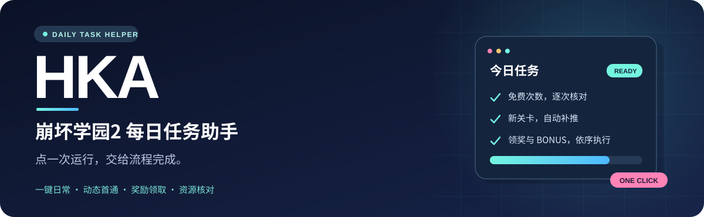
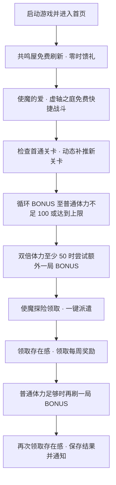

<p align="center">
  
</p>

<p align="center">
  
  
  
  <a href="LICENSE"></a>
</p>

<h1 align="center">HKA · 崩坏学园2每日任务助手</h1>

<p align="center"><b>点一次「运行今日任务」，让日常按流程完成。</b><br>商店领取 · 免费快捷战斗 · 动态补推 · BONUS 循环 · 奖励领取</p>

<p align="center">
  <a href="#-快速开始">快速开始</a> ·
  <a href="#-每日流程">每日流程</a> ·
  <a href="docs/configuration.md">配置指南</a> ·
  <a href="https://github.com/lolineet/Honkai2Automation/issues">反馈问题</a>
</p>

> **使用方式：双击 `打开助手.bat` → 配置模拟器 → 点击「运行今日任务」。**
>
> 助手打开后保持待机。本轮结束后回到待机；默认不设置开机启动，也不自动开始下一轮。关闭 BAT 窗口即停止服务和当前任务，ADB 子进程不额外弹出控制台窗口。

## ✨ 能做什么

| 功能 | 执行方式 |
| :--- | :--- |
| 🛒 商店日常 | 共鸣屋核对免费次数后刷新；零时馈礼核对价格为 0 后购买 |
| ⚡ 免费快捷战斗 | 使魔的爱、虚轴之庭；每次结算后重新读取剩余免费次数 |
| 🗺️ 动态补推 | 检查 1-1、1-2、1-3、2-1；继续识别新解锁的 2-2、2-3 等关卡 |
| 🔁 BONUS 循环 | 每局后读取普通体力，达到门槛才继续；双倍券与战斗按键可配置 |
| 🎁 连续领奖 | 使魔探险领取与派遣、存在感奖励、每周奖励、补刷后再次领取存在感 |
| 🧩 自定义流程 | 调整顺序、启停任务、编辑步骤、设置星期／日期／活动日期范围 |
| 📷 画面与日志 | 实时截图、裁剪按钮模板、单任务测试、运行报告和失败截图 |
| 📮 完成通知 | HTTP Webhook、SMTP 邮件；可分别开启成功和失败通知 |

**当前适配基准：Windows + MuMu 模拟器 + B服 + 1600×900 横屏。**
其他区服、模拟器与界面布局需要检查连接参数并校准识别。HKA 参考 [BAAH](https://github.com/BlueArchiveArisHelper/BAAH) 的使用方式与任务流水线理念，使用 Python 独立实现。

## 🚀 快速开始

### 1. 下载并安装

Windows 免安装版：解压完整的 `HKA-Windows-x64.zip`，进入文件夹，双击 `打开助手.bat`。
BAT 在窗口中运行服务，关闭窗口即停止服务和当前任务；关闭网页不会停止服务。
自带 Python、依赖、OCR 模型和 ADB，无需安装 Python 或单独下载 ADB；首次启动自动生成配置。
仍需安装并登录模拟器。设备地址默认 `auto`，识别唯一已连接的本地模拟器；未检测到设备或有多个模拟器时，填写模拟器设置中显示的实际 ADB 地址。ADB 路径默认 `builtin`（内置）；也可填写模拟器自带 ADB 的完整路径或所在文件夹。
配置、模板和运行记录保存在解压目录，请放在有写入权限的位置。
升级前备份并保留 `config.json`、`templates/`、`state.json` 和 `runs/`。

维护者可在已安装依赖的 Windows x64 Python 3.10 环境执行
`.\.venv\Scripts\python.exe tools/build_portable.py` 生成免安装包。
打包使用当前工作区代码和当前环境的依赖，版本清单随包提供。

准备 **Python 3.10 及以上**、安卓模拟器和可用的 **ADB**。开启模拟器 ADB 调试，建议先设置为 **1600×900**。

```powershell
git clone https://github.com/lolineet/Honkai2Automation.git
cd Honkai2Automation
python -m venv .venv
.\.venv\Scripts\python.exe -m pip install -e .
if (-not (Test-Path -LiteralPath config.json)) {
    Copy-Item config.example.json config.json
}
```

也可以下载仓库 ZIP，解压后在项目目录执行创建环境、安装和复制配置的命令。

### 2. 配置模拟器

双击 **`打开助手.bat`**，打开本地界面 [127.0.0.1:8765](http://127.0.0.1:8765)。在「模拟器」页填写：

| 配置 | 填写内容 |
| :--- | :--- |
| ADB 路径 | 模拟器自带的 ADB 程序完整路径，或已加入 PATH 的 `adb` |
| 设备地址 | 模拟器实际 ADB 地址；示例中的 `127.0.0.1:5555` 只是占位值 |
| 游戏包名 | 示例为 B服 `com.miHoYo.HSoDv2BiliBiliRelease`；其他渠道填写实际包名 |
| 启动程序 | 可选；填写后，未连接时可尝试启动模拟器，并等待连接 |

点击 **「检测连接」**，确认能获取游戏截图。首次使用在「任务流程」检查选项并测试单个任务，再运行整套流程。

若默认端口被其他程序占用，双击 `打开助手.bat` 会自动选择空闲端口并打开正确页面。重复双击会打开当前助手的页面；实际地址也会显示在 BAT 窗口中。启动出错时窗口会保留错误提示。

### 3. 点一次，完成今日任务

启动游戏时自动识别资源更新及协议／隐私授权提示，确认更新或同意后继续进入游戏，无需额外配置。
资源更新最多等待 15 分钟，可随时点击「停止」；登录验证码仍需手动处理。

**「任务流程」→ 保存配置 →「运行今日任务」。**

- `config.example.json` 已包含按顺序启用的 OCR 日常流程，常规 BONUS 默认关闭双倍券。
- 「签到、连登与生日奖励」默认启用，自动连续领取每日签到、连登和角色生日奖励；生日界面自动送上祝福并领取，无需配置日期或按钮模板。已有的签到与连登流程自动获得此能力。
- 邮件、节日示例默认关闭。需要在「画面与模板」裁剪对应按钮，再配置并启用。
- 网页可以关闭，后台继续本轮执行；重新打开可查看结果。结束后台服务会中断运行。
- 当天已完成的任务自动跳过；示例配置以游戏 **04:00** 为每日刷新时间。

## 🔄 每日流程



### 关卡会变化，流程跟着当前画面判断

- **虚轴之庭：** 每轮重新读取免费次数，可能执行两轮、三轮或其他剩余次数；确认次数与剩余次数变化不一致时停止该任务。
- **日常体力本：** 根据「难度指数 B」和剩余活动时间识别入口。先恢复关卡选择页，避免进入上次停留的地图。
- **首通检查：** 最高得分为 0 才补推，已通关自动跳过；通关后等待解锁动画，再确认下一关是否出现。
- **BONUS：** 每局重新检查体力，记录完成局数和停止原因；主循环与领取奖励后的单局分别配置。

## 🛡️ 资源核对

| 操作 | 执行条件与保护 |
| :--- | :--- |
| 共鸣屋刷新 | 必须看到剩余免费次数，并确认免费刷新提示 |
| 零时馈礼 | 价格和购买按钮完整显示，且价格为 0 |
| 快捷战斗 | 核对免费次数及预期体力消耗；虚轴之庭用完免费次数后的付费重打入口直接结束 |
| 常规 BONUS | 普通体力至少 100；不足时结束，不兑换资源补足 |
| 双倍体力额外 BONUS | 双倍体力至少 50，每日最多额外一局，固定关闭双倍券 |
| 双倍体力兑换 | 连续两次读取资源与兑换提示，再核对兑换后的两个体力池；出现水晶文字、钻石图标或未知提示时取消，并检查后续弹窗 |

这些保护依赖当前画面的识别结果。不能确认页面、价格、次数或资源时，该任务会停止并记录错误；游戏改版后需要重新检查适配。

## 🎛️ 按你的习惯配置

在 **「任务流程」** 中调整顺序、启停任务和编辑步骤，点击顶部 **「保存配置」** 生效。

- **失败处理：** 可设置某项失败后是否继续。示例中启动／登录为必要步骤，失败时停止；其他任务失败后记录并继续。
- **战斗方案：** 移动与射击，或仅操作技能按键；三个技能分别支持关闭、点按、长按、进图使用一次。
- **双倍券：** 常规 BONUS 可自行开启；领取存在感后的 BONUS 最多一局，独立设置。
- **活动任务：** 按指定星期、日期、每年生日日期或活动日期范围执行。
- **通知：** 默认 QQ 邮箱，填写 QQ 号和 SMTP 授权码即可给自己发送通知，可发送测试邮件。也支持其他 SMTP 邮箱与 Webhook。
- **装备爆仓：** OCR 识别到装备仓库已满提示时停止后续任务、保存截图，并通过页面及已启用的失败通知提醒整理装备。

详见 **[配置指南：任务步骤、日期规则、通知与命令](docs/configuration.md)**。

## 📌 当前验证与适配范围

- 本机 B服已验证商店领取、两类快捷战斗、BONUS 多局循环、探险与奖励领取。
- 已实测 **2-1 → 解锁 2-2 → 解锁 2-3** 的补推与战斗结算，并确认未出现下一关后结束补推。
- 登录验证码、账号重新登录需要人工处理。
- 角色生日奖励已合并到默认每日领奖流程；节日活动提供可编辑示例，需根据当期活动、对应区服画面配置。
- **空想迷域暂未纳入每日自动化。** 界面改版、地图美术或缩放变化可能需要重新校准。
- 按键长按采用顺序输入，不代表持续多点触控；工具通过 ADB 操作界面，不读取游戏内部数据。

## 🧰 项目结构与检查

```text
Honkai2Automation/
├─ hka/                   # ADB、OCR、游戏流程、任务执行与网页界面
├─ tests/                 # 流程判断、资源核对和配置检查
├─ docs/                  # 配置指南与 README 横幅
├─ config.example.json    # 一键日常示例配置
├─ 打开助手.bat           # Windows 前台启动入口，关闭窗口即停止服务
├─ start_hka.pyw           # 后台服务启动与单实例处理
└─ pyproject.toml         # 安装配置
```

用户配置 `config.json`、模板 `templates/`、完成记录 `state.json` 和运行截图／报告 `runs/` 保存在本地，并已加入 Git 忽略规则。

```powershell
.\.venv\Scripts\python.exe -m unittest discover -s tests -q
```

## 🙏 致谢与许可

感谢 [BAAH · 碧蓝档案爱丽丝助手](https://github.com/BlueArchiveArisHelper/BAAH) 提供的使用方式与流水线设计参考。

本项目采用 [MIT License](LICENSE)。
